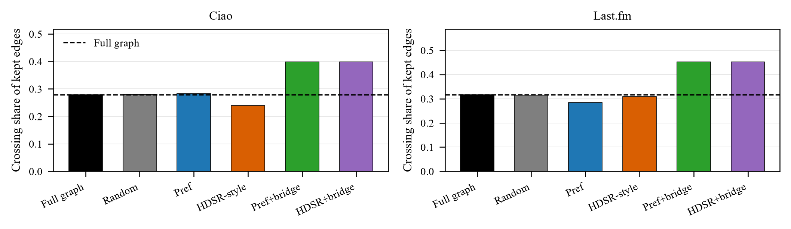
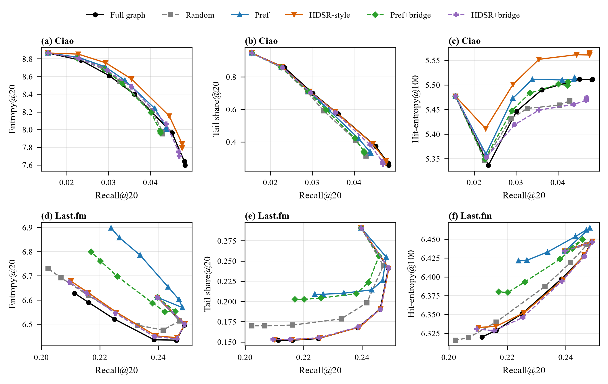
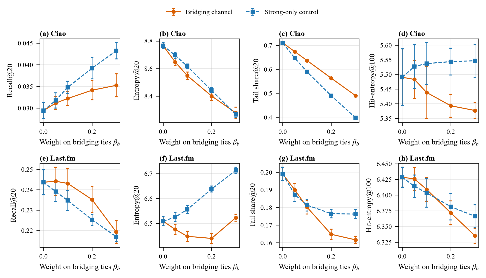

<div align="center">

# 🌉 Structure-Aware Social Recommendation
### Do Bridging Weak Ties Make Social Recommenders More Diverse?


**🔗 Strong ties give accuracy. Do weak ties give discovery?**

*Course project, Social Networking & Mining, IGDTUW*

</div>

---

## 📌 Overview

Social information improves recommendation accuracy, but it can also make recommendations less diverse.  
Many denoising methods prune social edges by preference similarity or node degree, without asking whether an edge connects different communities.

This project is a **controlled study**: one simple recommender (ItemKNN + friends' votes) is kept fixed and only the **social-edge selection** changes. This isolates the effect of *which* ties are kept. It is not a state-of-the-art model.

## ✨ Key Features

- ✅ Edge features: tie strength, preference similarity, Louvain community crossing, Burt constraint, novelty gain
- ✅ Two datasets: Ciao and Last.fm (HetRec 2011)
- ✅ Six edge selectors at an equal edge budget (full, random, pref, HDSR-style, pref+bridge, HDSR+bridge)
- ✅ Two definitions of a bridging tie (Louvain crossing, low Burt constraint)
- ✅ Bridging-channel vs strong-only control at equal total social weight
- ✅ Accuracy and diversity metrics, including **hit-only diversity**
- ✅ One-command reproducible tables and figures

## 🎯 Research Questions

| # | Question |
|---|---|
| RQ1 | Do preference-based pruners remove bridging ties more often than chance? |
| RQ2 | At equal edge budget, does protecting bridging ties improve diversity at acceptable accuracy cost? |
| RQ3 | Does a bridging channel add diversity beyond giving the same weight to strong ties? |

## 🧠 Edge Selectors

| Selector | Idea |
|---|---|
| 🌐 `full` | keep all social edges |
| 🎲 `random` | keep a random subset |
| 🤝 `pref` | keep edges with highest item-Jaccard similarity |
| 📉 `hdsr` | HDSR-style edge weight (our re-implementation of Eq. 7-9, deterministic pruning) |
| 🌉 `pref+bridge`, `hdsr+bridge` | same, plus a bonus for bridging edges |

## 📊 Metrics

| Type | Metrics |
|---|---|
| Accuracy | Recall@K, NDCG@K |
| Diversity | Coverage@K, Entropy@K, Tail share@K |
| Useful diversity | Hit-coverage, hit-entropy, hit-tail-share (only over correct recommendations) |

> Coverage@100 saturates (about 0.94 on Ciao and 0.96 on Last.fm), so results use K=20 and entropy / tail share.

## 🔍 Main Findings (3 seeds, mean ± std)

| | Ciao | Last.fm |
|---|---|---|
| Social signal (Recall@20, none → full graph) | 0.016 → 0.048 (large gain) | 0.240 → 0.249 (small gain) |
| Entropy@20 / tail share@20 (none → full) | 8.87 → 7.64 / 0.95 → 0.27 (big drop) | 6.61 → 6.50 / 0.29 → 0.24 (small drop) |
| RQ1: share of lowest-weight 30% edges that cross communities | pref 0.267 (below chance 0.274-0.284); HDSR 0.371 (above) | pref 0.394 (above chance 0.304-0.329 in all seeds); HDSR 0.334 (borderline, above in 2 of 3 seeds) |
| RQ2: bridge protection vs same selector without it | no diversity gain (either bridge definition) | no difference (all selectors within about 1 std on accuracy) |
| RQ3: bridging channel vs strong-only control (weight 0.3) | higher tail share (0.49 vs 0.40), lower recall, lower hit-only diversity | recall about equal (0.219 vs 0.217), but lower entropy (6.52 vs 6.71), lower tail share (0.162 vs 0.176) and lower hit-entropy; no diversity benefit |

Reading: the effect of *which* ties are kept depends on the dataset. On both datasets bridge protection and a bridging channel did not give useful diversity gains.  
Differences within one standard deviation should be read as no difference.  
Full tables: `results/ciao_v2_tables.txt`, `results/ciao_lowcon_tables.txt`, and the Last.fm tables in `results/` (see `docs/datasets.md`).

## 🖼 Figures

| Kept edges | Trade-off | Bridge channel |
|---|---|---|
|  |  |  |

## ⚙ Tech Stack

Python 3.13 · NumPy · SciPy · pandas · NetworkX (Louvain, Burt constraint) · Matplotlib. CPU only, no GPU needed.

## 🔄 Workflow

```text
raw data → filter (users ≥5, items ≥2) → split 70/10/20 → edge features
→ Step 1 diagnostic → edge selectors (same budget) → ItemKNN + social score
→ choose beta on validation → test metrics → tables and figures
```

## 📂 Repository Structure

```text
social-bridge-rec/
├── src/
│   ├── socrec.py            # data, edge features, selectors, recommender, metrics
│   ├── run_experiments.py   # diagnostic, Exp 1, Exp 2
│   ├── make_tables.py       # mean ± std tables
│   ├── plots.py             # three figures (quick, per dataset)
│   ├── paper_figs.py        # publication-style figures for the paper (Ciao + Last.fm)
│   ├── check_ties.py        # sanity check on candidate scores
│   ├── peek.py              # inspect a raw data file
│   └── make_synthetic.py    # fake data for smoke tests only
├── results/                 # CSVs, tables, figures, logs
├── docs/                    # related-work table, references
├── paper/                   # main.tex, references.bib, figures/, final PDF
├── requirements.txt
└── README.md
```

## 🚀 Installation

```bash
git clone https://github.com/Siddiqua2007/social-bridge-rec.git
cd social-bridge-rec
python -m venv venv
venv\Scripts\activate
python -m pip install -r requirements.txt
```

## ▶ Run

Data is not stored in the repo. Last.fm: see `docs/datasets.md` for source, flags and preprocessing. Place the Ciao files (from the DivSR repository) under `external/DivSR/data/ciao/`.

```bash
cd src
python run_experiments.py --inter ..\external\DivSR\data\ciao\ciao.train.rating --social ..\external\DivSR\data\ciao\ciao.links --seeds 3 --betas 0 0.1 0.2 0.3 0.5 0.7 0.9 --out ..\results\ciao_v2
python plots.py ..\results\ciao_v2
python make_tables.py ..\results\ciao_v2
```

Burt-constraint bridges: add `--bridge lowcon` and use a different `--out`.

Paper figures (Ciao and Last.fm results together, single-column size):

```bash
python paper_figs.py ..\results\ciao_v2 ..\results\lastfm_lakshmi_v2 ..\results\final col
```

## ⚠ Limitations

- ItemKNN recommender (no GNN)
- Undirected graph
- Random split
- Only the DivSR train file as interaction pool
- Item-level aggregate diversity only
- Two datasets (Ciao, Last.fm)
- Low-Burt-constraint bridges were run on Ciao only, not on Last.fm
- 3 seeds, no significance tests
- HDSR is a re-implementation

## 🔍 Keywords

Social Recommendation • Structural Holes • Weak Ties • Diversity • Edge Pruning • Long-tail • Louvain • Burt Constraint • Ciao • Last.fm

## 👩‍💻 Contributors

**Siddiqua Abedeen** · **Lakshmi Prajapati** · **Jyoti**  
*Guide: Dr. Jyoti Shokeen, Indira Gandhi Delhi Technical University for Women (IGDTUW)*

## ⭐ Support

If you found this project useful, consider giving it a ⭐ on GitHub.

<div align="center">

---

**🌉 Better recommendations begin with better ties**

</div>